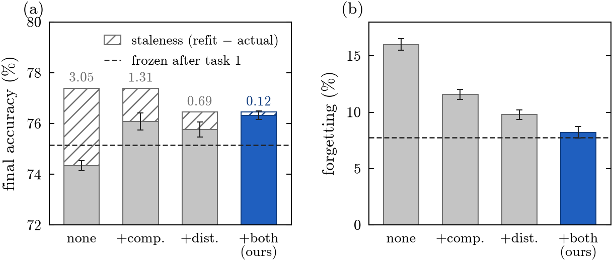

# One Adapter, One Pass: Are Modular Adapters Necessary for Class-Incremental Learning?

Code for the paper by Alejandro Dopico-Castro, Oscar Fontenla-Romero, Bertha Guijarro-Berdiñas and
Amparo Alonso-Betanzos (Universidade da Coruña, CITIC).

> **Abstract.** Learning new classes over time without forgetting previous ones remains a central challenge for
> intelligent systems. Pre-trained models ease this problem: a frozen backbone can be complemented with
> lightweight adaptation modules and a closed-form classifier. However, continually adapting the representation
> makes the statistics stored by the classifier obsolete. A growing trend instead isolates knowledge in
> additional modules. In this work, we question whether such modularity is necessary. We show that most of the
> forgetting of a single, continually adapted module stems from classifier obsolescence rather than from a
> loss of representation quality. Correcting it through closed-form drift compensation and feature distillation
> allows a single adapter to match or surpass modular methods with a single forward pass. Moreover, a controlled
> study shows that isolating knowledge in modules protects it only when tasks are clearly separated, a condition
> rarely met in standard benchmarks.

## Idea

A single adapter, shared by all tasks, is trained continually on a frozen ViT-B/16 and read out by a ridge
classifier built from accumulated feature statistics. Two mechanisms keep the adapter consistent with that
classifier:

- **drift compensation**: after each task, the stored statistics are transported to the feature space of the new
  adapter with a ridge-regressed linear map `P` (paper Eqs. 3-4);
- **feature distillation**: while training, the embeddings of the current batch are kept close to those of the
  previous adapter (Eq. 5), so that the drift stays small and linear.

Inference is one forward pass through one adapter followed by a linear classifier.



*Without protection, continual adaptation leaves the classifier stale (hatched, 3.05 points on ImageNet-R) and
forgets more than freezing the adapter after task 1 (dashed). Compensation and distillation together remove the
staleness (0.12) and bring forgetting down to the level of the frozen model.*

## Results

Final accuracy (%, mean over three class orders; ViT-B/16 IN-21K, adapters on blocks 3-11, bottleneck 16).
*Passes* is the number of ViT forward passes per test image (`T` = number of tasks).

| Method | Passes | ImageNet-R (10 tasks) | CIFAR-100 (20 tasks) | VTAB (5 tasks) |
|---|---|---|---|---|
| No adapter | 1 | 64.9 | 85.7 | 92.8 |
| Frozen after task 1 | 1 | 75.1 | 89.1 | 93.3 |
| SEMA | 1 | 73.5 | 83.0 | 87.1 |
| EASE | T | 75.1 | 84.7 | 92.2 |
| TUNA | T+1 | **78.8** | **90.6** | 92.2 |
| **Ours** | **1** | 76.3 | 90.0 | **94.1** |

TUNA is more accurate on ImageNet-R and CIFAR-100 but needs T+1 passes: about 11x the energy of our single
pass (5252 J vs 456 J per 1000 images, RTX 4090). On VTAB, when tasks mix several domains, isolation-based
methods degrade while the shared adapter barely changes; the full tables and figures are in the paper.

## Install

```bash
uv sync
uv run pytest
```

Python 3.11 (pinned in `.python-version`). Backbone weights (`vit_base_patch16_224.augreg_in21k`) are downloaded
by `timm`.

## Data

`--data-root` must contain `cifar-100-python/`, an ImageNet-R folder with `train/<class>/` and `test/<class>/`,
and the VTAB-CIL domains (see `datasets/registry.py` for the exact layout).

## Reproducing the paper

Every method is one YAML file, and `train.py` runs one (benchmark, method, seed) triple:

```bash
uv run python train.py \
  --benchmark configs/benchmarks/imagenet_r_b0_inc20_200_in21k.yaml \
  --method configs/methods/ours.yaml \
  --data-root /path/to/data --output-root runs/ours --seed 1993
```

| Paper element | Config (`configs/`) |
|---|---|
| Ours (Table 1, Fig. 1 "both") | `methods/ours.yaml` |
| Fig. 1 ablation: none / comp. / dist. | `methods/ablation_none.yaml`, `ablation_comp_only.yaml`, `ablation_distill_only.yaml` |
| No adapter, frozen after task 1 | `methods/no_adapter.yaml`, `methods/frozen_after_task1.yaml` |
| EASE, TUNA, SEMA with matched adapters (Table 1) | `baselines/fair/{ease,tuna,sema}_b3.yaml` |
| EASE, TUNA, SEMA, original recipe (cost study) | `baselines/{ease,tuna,sema}.yaml` |
| Fig. 2 domain-isolated oracle (+ compensation) | `methods/domain_isolated_oracle{,_comp}.yaml` |
| ImageNet-R (10 tasks), CIFAR-100 (20 tasks) | `benchmarks/imagenet_r_b0_inc20_200_in21k.yaml`, `cifar100_b0_inc5_in21k.yaml` |
| VTAB, k domains per task (k=1..5) | `benchmarks/vtab_conc{1..5}_in21k.yaml` |

To run everything (3 class orders, seeds 1993-1995) and rebuild tables and figures:

```bash
DATA_ROOT=/path/to/data DEVICE=0 bash scripts/run_experiments.sh all   # hours per run; resumable
DATA_ROOT=/path/to/data DEVICE=0 bash scripts/postprocess.sh           # staleness, cost, figures
```

`results/` holds the post-processed numbers that the figures read (staleness, cost, inference budget), so
`uv run --extra figures python paper/make_figures.py` regenerates the plots once `runs/` exists. `paper/figs/`
has the figures as submitted.

The method is `methods/shared_adapter.py` (about 400 lines): `mode: shared` with `protect: distill` and
`compensate: true` is the paper's configuration, and `frozen` and `noadapt` are the two references of Table 1.

## Reproducibility notes

Runs are deterministic (see `utils/reproducibility.py`); each run directory stores its config, environment,
per-task accuracy matrix and `metrics.json`. Re-evaluate a checkpoint with
`uv run python evaluate.py --run-dir runs/<run> --data-root /path/to/data`.

## Development

```bash
uv run pre-commit install    # ruff + ruff-format on every commit
```

## Citation

The reference will be added once the paper is published.
